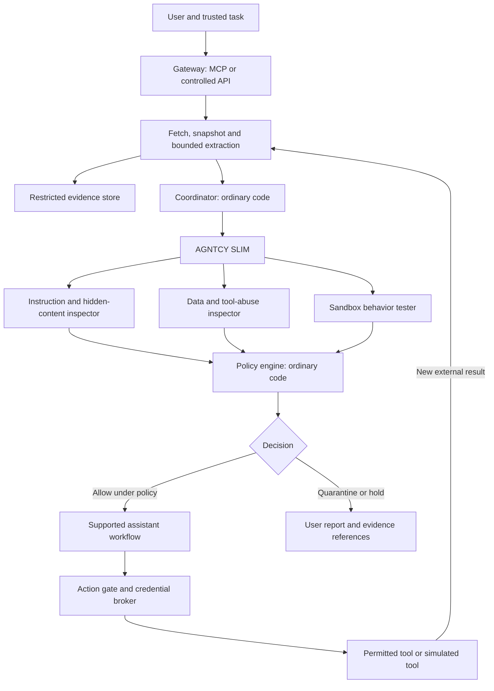

# AGNTCY prompt-injection protection gateway

Status: implementation design, not a deployed or validated security product. Updated October 10, 2026.

## 1. What we are building

A gateway that inspects external content before an AI consumes it, gathers evidence from specialist agents, and enforces permissions before supported tools execute. It helps identify prompt injection and limits what a missed attack can accomplish.

The central rule is simple: **external content can supply information, but cannot grant permission.** Passing an inspection does not make that content trusted. Agents investigate; application code controls access and actions.

“Void” means quarantine the source from the current workflow. It does not mean deleting the user's original email or file. The user sees what was held, why, and whether the inspection was complete.

## 2. Where protection applies

The same backend supports two adapters. Their coverage differs and must be visible in the interface.

| Mode | User experience | Enforceable coverage |
|---|---|---|
| Native Claude or ChatGPT through MCP | Enable our connector and request protected retrieval or inspection. Upload files through our interface, then provide a file ID. | Our connector's content and tools. Native uploads, pasted text, built-in browsing, unrelated tools, and the app's internal state remain outside our control. |
| Controlled API workflow | Use a small chat interface backed by the Claude or OpenAI API. | All supported inputs, model calls, tool results, output rendering, and tool execution in this application. Third-party clients and tools cannot bypass the gateway. |

Start with both adapters using one email workflow and the same policy engine. The MCP adapter is read-only in the first release. The controlled workflow demonstrates action enforcement using simulated email sending. Real sending remains disabled until the action tests pass and a provider integration is reviewed.

Native-chat users cannot be forced to invoke our connector. Inspection of content already pasted into a conversation is retrospective. Native-chat findings also cannot certify the consumer app's behavior: its private instructions and conversation state are not reproducible.

## 3. Small architecture

There are three running components: the gateway, a SLIM node, and a worker pool. Restricted storage belongs to the gateway. Coordination, policy checks, credential brokerage, and the initial simulated action executor are modules of the gateway rather than separate services.

The diagram's assistant-to-action-gate path is mandatory in the controlled workflow. In native chat it applies only to tools exposed by our connector; native tools do not travel through this path. Quarantined and held content never reaches the assistant as usable context.

For the demo, use a Python gateway, SQLite for durable job metadata, an encrypted evidence volume, one SLIM node, and fixed worker identities. Keep storage permissions separate from worker permissions. Production requires a review of isolation, retention, availability, and tenant separation before moving to managed database and object storage. Pin dependencies and AGNTCY versions after a compatibility smoke test; no unverified version assumptions are part of this design.

## 4. Agents and AGNTCY's role

Three specialist workers cover the five inspection responsibilities previously discussed. Hidden-content extraction and cheap rule checks run before model-based inspection. The coordinator is not an LLM.

| Worker | Responsibility | Evidence |
|---|---|---|
| Instruction and hidden-content inspector | Inspect visible and hidden text, role impersonation, task redirection, and bounded decoding. Distinguish suspicious instructions from legitimate quotations and document procedures. | Source locations, observed patterns, bounded reason codes, and uncertainty. |
| Data and tool-abuse inspector | Identify requests for private information, unauthorized destinations, commands, file changes, downloads, or messages. Compare requested behavior with the fixed task policy. | Proposed operation, source of its arguments, policy conflict, and uncertainty. |
| Sandbox behavior tester | Run the intended task against the inspected snapshots using a representative model configuration, fake private data, and simulated tools. | Instrumented tool attempts, dummy-state changes, observable task deviation, and test limitations. |

SLIM carries job assignments and findings. AGNTCY Identity authenticates workers; the gateway additionally checks application message identity, allowed role, job assignment, tenant, version, and replay protection. Mesh membership alone is not authorization to submit any finding.

SHADI restricts worker processes on a supported, verified platform. Workers have fresh per-job state, read access only to assigned inputs, bounded output access, no production tool credentials, and no permission to change policy. Destroy their scratch data after the job.

Use a fixed, approved worker roster. OASF records describe roles and versions. Automatic discovery and arbitrary third-party agents are deferred: discovered capabilities do not establish trust. Trace jobs using AGNTCY-compatible telemetry, excluding content and credentials from ordinary traces.

## 5. End-to-end workflow

1. **Authenticate and authorize the request.** Resolve the user and tenant from verified session credentials. A controlled client supplies the original task. For MCP, sensitive task authorization must come from a user-owned gateway session, not an assistant's assertion that the user approved something.
2. **Select a task policy.** The first supported policies are `summarize_email`, `extract_invoice`, and `simulate_send`. Natural-language task classification may suggest a policy but cannot grant capabilities. Ambiguous requests require explicit user selection or remain read-only.
3. **Retrieve and snapshot.** The gateway reads only authorized mail items or uploaded resources. Preserve original bytes, extracted views, source locations, hashes, and extractor version. Extraction runs in a credential-free, network-restricted subprocess in the worker pool, never in the privileged gateway process. No remote content executes during extraction.
4. **Run bounded preprocessing.** Inspect MIME type, limits, hidden HTML, Unicode, and permitted encoding layers. Unsupported content or incomplete extraction remains on hold. Never silently truncate a file and approve the uninspected remainder.
5. **Dispatch inspections over SLIM.** Send opaque resource IDs and short-lived, job-scoped retrieval capabilities rather than broadcasting whole documents. Credentials bind retrieval to the assigned worker, tenant, resource, and expiry.
6. **Gather evidence.** Workers read only their assigned content. The coordinator checks result structure, assignment, source references, and completeness. A gateway-owned simulated-tool collector records behavior; model-written claims and worker-authored logs cannot substitute for collector events. A valid signature proves who submitted a result, not that its conclusion is correct.
7. **Apply the decision table below.** No worker, majority vote, confidence score, or source text can override policy. Findings remain allegations unless supported by observable evidence or a verified deterministic condition.
8. **Deliver bounded results.** Released content remains labeled untrusted and tied to the inspected snapshot and task. In controlled mode, provide source-backed structured fields where possible. The planner receives task state and opaque identifiers; it has no direct need to read raw documents. Schema validity alone does not make extracted values authoritative.
9. **Check proposed actions.** Every controlled tool call goes through the action gate. Sensitive actions require an exact user confirmation in the gateway interface. The initial release records simulated effects only.
10. **Inspect new content.** External results and follow-up resources return to ingestion. A changed resource set, task, policy, model configuration, or relevant context invalidates reuse of previous scan decisions.

The sandbox receives the relevant supported document set together, not only isolated files. Keep context finite: if the complete set exceeds the budget, hold or narrow the task with the user's involvement. Do not certify context that was not inspected.

## 6. Decisions and failures

| Condition | Decision | Result |
|---|---|---|
| A verified deterministic rule forbids the operation, or sandbox telemetry establishes a forbidden attempted operation | `QUARANTINE` | Withhold the source from this workflow and report evidence. |
| Model inspectors report suspicious instructions without sufficient corroboration | `REVIEW` | Withhold pending an understandable user review; do not present the allegation as proven. |
| Unsupported format, incomplete extraction, invalid finding, missing worker, timeout, exhausted budget, or contradictory evidence | `REVIEW` | Remain on hold with a specific reason. Never count an error as a blocked attack or a successful inspection. |
| All required checks completed without a policy violation or unresolved suspicion | `ALLOW_UNDER_POLICY` | Release only the inspected result under existing restrictions. No declaration that the source is universally safe. |

Job states are `QUEUED -> EXTRACTING -> INSPECTING -> DECIDED`, with terminal `FAILED` or `CANCELED` states that release no content. Store progress durably. After a crash, reclaim expired worker leases and retry only within the configured budget. Duplicate results do not advance completeness twice.

Content state and action state are separate. An allowed source does not approve an action. An expired scan or approval requires a new decision. Pausing for review does not silently fall back to unrestricted execution.

Review can reject content, request a narrower task, or allow a bounded read-only result with a recorded exception. An exception is eligible only when extraction and every required inspection completed and the remaining issue is uncorroborated suspicion. Missing coverage, isolation failure, invalid bindings, verified quarantine, and expired context cannot be waived. The decision remains `REVIEW` with an explicit exception, never a fabricated clean scan. An exception cannot grant blanket tool access or disable tenant and data-disclosure rules. Provide an explicit cancellation path.

## 7. Action enforcement and data origin

The gateway maintains source and disclosure labels for data, including derived values. Labels are owned by code and travel with data; agents cannot remove or upgrade them. Combining values preserves the most restrictive disclosure constraints. Privately sourced derived text remains private unless an explicit, authorized disclosure decision permits otherwise.

| Task | Permitted | Forbidden by default |
|---|---|---|
| Summarize email | Read the selected email; return a source-backed summary to its authorized user. | Sending, modifying, deleting, exporting unrelated data, or fetching embedded remote links. |
| Extract invoice | Read selected content; return referenced amount, currency, date, and invoice ID. | Payments, changing bank details, treating source-supplied destinations as approved contacts. |
| Simulate send | Record an explicitly confirmed action against dummy state. | Any real delivery or production credential access. |

For a future real send, the executor verifies user and tenant, active policy, exact recipient, attachment IDs and hashes, body hash, data-disclosure rules, and a one-use expiring confirmation. The user sees the exact action in our interface. Changing any argument invalidates confirmation. Approval to read a file is never approval to distribute it.

Recipient addresses from documents remain untrusted values. Resolve destinations from an approved contact source or explicit user selection. URL fields do not cause automatic fetching. Tool arguments are typed and validated, but authorization is checked separately from format validity.

Use an idempotency key and durable action record. After an ambiguous provider response, mark `UNKNOWN_OUTCOME` and reconcile with provider status; do not blindly resend. Stop and cancellation revoke pending capabilities but cannot undo an already completed external action. Before a production provider is enabled, enforce the same contract there and prove it with integration tests.

This design implements scoped origin and disclosure checks. It does not claim a formal proof of general information-flow security or equivalence to the CaMeL research interpreter.

## 8. Isolation, fetching, and secrets

Separate the retrieval service, model broker, and action executor from untrusted worker code. Each gateway module has its own credential scope. A worker receives neither mailbox tokens nor model-provider API keys. The gateway's privileged modules handle typed requests and never execute commands or policies extracted from content.

Workers communicate only through approved local broker/SLIM paths. Remote model calls pass through the model broker, which enforces provider, request shape, tenant quota, payload budget, and timeout. Model endpoints are approved data processors: sending content to them is a disclosure governed by consent and retention rules, not a claim that data stays local.

Verify OS/network isolation using direct socket and subprocess tests on the chosen platform. SHADI's exact hostname restrictions vary by configuration and platform. A Python hook or environment proxy setting alone is insufficient; direct connections must also be blocked. If the desired restriction cannot be demonstrated, do not launch workers with broader permissions. Use a verified OS/VM network boundary instead.

For a later website adapter, enforce HTTP(S) only, limits, redirect budgets, and public-destination checks on every connection. Reject loopback, private, link-local, metadata-service destinations, embedded credentials, and unexpected ports. Validate actual connection destinations to resist DNS rebinding. Start with static HTML; dynamic pages that cannot be completely inspected remain unsupported. Disable scripts and remote resource loading in evidence views.

Initial supported inputs are plain text and bounded email MIME/HTML bodies. Hold attachments, PDFs, archives, images, and audio as unsupported until isolated extraction and coverage tests exist. Never summarize an email as fully inspected when its relevant attachments were skipped.

## 9. Answers, evidence, and persistent state

Read-only answers can still be manipulated. For invoice extraction, require source offsets for every field and flag mismatches. Do not let the model invent missing amounts or account details. Summaries have a remaining semantic integrity risk and must expose their supporting sources. Native chat controls its own final response, so our connector cannot enforce its rendering or verify every claim it adds.

In controlled mode, render escaped text and vetted links only. Disable arbitrary HTML, remote images, auto-fetching, and executable markup. Treat a generated response as untrusted at every subsequent destination.

Blocked reports contain a reason code, source ID, inspection completeness, and evidence reference. They do not echo attack instructions into the main assistant conversation. Users inspect bounded excerpts in a text-only view; copy/export is explicit. A report viewer cannot initiate tools or network requests from evidence text.

Workers have no cross-job memory. External content cannot automatically enter persistent assistant memory or a retrieval index. If these features are added, preserve origin labels, recheck context composition, and enforce write authorization before storage and inspection before retrieval.

## 10. Minimal contracts and storage

| Record | Required fields |
|---|---|
| Resource snapshot | Tenant, owner, source ID, original/extracted hashes, extractor version, immutable storage references. |
| Scan job | Tenant, user, policy and task version, resource-set hash, model/configuration and worker prompt/build versions, required workers, budget, deadline, status. |
| Finding | Job ID, assigned worker identity/version, resource hash, bounded category, evidence references, inspection status, nonce. |
| Decision | Job ID, policy version, completed checks, decision, reason codes, evidence IDs, expiry. |
| Action | Tenant/user, typed operation and arguments, source labels, confirmation digest/expiry, idempotency key, execution status. |

Every lookup checks the authenticated tenant and resource authorization, even with an apparently unguessable ID. Worker messages cannot choose their own tenant, job assignment, storage paths, or tool privileges. Validate lengths and schemas before accepting or storing findings. Keep append-only decision events separate from raw content access.

The initial service surface is small. Only the first three operations are exposed through read-only MCP; action operations require the controlled user/API workflow:

- `inspect_resource(resource_id, task_session_id)` starts or resumes an authorized scan.
- `get_scan_status(scan_id)` returns bounded progress and decisions.
- `get_inspected_result(scan_id)` returns only permitted, task-scoped output for the same authorized user.
- `propose_simulated_action(task_session_id, typed_action)` creates a pending exact-action confirmation.
- `confirm_simulated_action(action_id, digest)` stores exact approval from the authenticated user interface.
- `execute_simulated_action(action_id)` verifies the stored approval and records the dummy effect; it accepts no model-written confirmation.

Authenticated user context is derived server-side. A client-supplied role, approval string, tenant ID, or “safe” flag is not authority. Upload and account linking occur through the gateway interface, not by giving agents credential material.

## 11. Privacy, performance, and operations

Use approved model processors and least-privilege mailbox scopes. Minimize shared context without omitting data required to assess the task. Confidential resources with no approved model processor remain unavailable for model-based inspection. Redaction changes inspection coverage and must be reported.

Keep raw content encrypted and access-controlled. Ordinary traces contain IDs, durations, versions, and reason codes rather than excerpts or secrets. Proposed demo defaults are: evidence expires after 24 hours, metadata after 7 days, and job-scoped tokens after 5 minutes or job termination. Document provider-side retention separately. Deletion removes snapshots, scratch data, and derived artifacts; backups and any immutable logs need a defined expiry rather than a promise of instant erasure.

Proposed starting limits, to be tuned using measurements: 1 MiB per source, 2 MiB and 10 sources per task, 100,000 extracted characters, 60 seconds per scan, one worker retry, two concurrent scans per user, and a fixed per-job model-token budget. Exceeding any required coverage limit produces review, not a partial approval. Missing limits block production configuration.

Cheap preprocessing runs first. Confirmed hard violations can stop further costly work. Otherwise, all required inspectors finish within the budget; skipped checks are explicitly reported. The first release always runs the behavior tester on eligible tasks. A future risk-based skip rule requires evaluation and a visible change in coverage.

Expose queue status and cancellation. Monitor incomplete inspections, false blocks, latency, costs, worker authentication failures, and action denials. A worker crash isolates that job. A SLIM, broker, storage, or model outage prevents new releases; already-issued decisions remain usable only if still bound to unchanged context and an active policy. Emergency controls stop retrieval, cancel queued jobs, and revoke pending actions.

Deploy with authentication, TLS, versioned configuration, restricted volumes, and tested rollback. On upgrades, invalidate affected decisions and run compatibility/evaluation checks before traffic is enabled. Do not use shared production secrets or disable isolation to make a demo pass.

## 12. Proof required before real actions

These are release gates to implement and run. They are not claims that the current repository has passed tests.

| Gate | Passing evidence |
|---|---|
| Coverage | Every supported controlled-mode input and tool result goes through ingestion; attempts to bypass the action gate fail. MCP limitations are visible. |
| Authority | Content and model-written approvals cannot expand capability sets, change recipients, authorize another tenant, or reuse expired/modified confirmations. |
| Isolation | Workers cannot read production secrets, access other jobs, contact arbitrary endpoints, or escape through subprocesses and direct sockets. |
| Complete inspections | Missing workers, malformed findings, unsupported formats, budget exhaustion, duplicate messages, and crashes never produce approval. |
| Content binding | Changed bytes, resource sets, policy, task, model configuration, or relevant context invalidate decisions. Replay of an old finding cannot approve a new job. |
| Behavior evidence | Seeded forbidden dummy actions are detected from tool telemetry even if the model's final response looks harmless. |
| Answer integrity | Source-backed extraction flags incorrect amounts; malicious reports and markup cannot create an executable or remote-fetch path. |
| Privacy | Tenant isolation, token expiry, log minimization, retention cleanup, and permitted-provider restrictions work as configured. |
| Recovery | Cancellation, restart, retries, and ambiguous action outcomes do not duplicate actions or silently release uninspected content. |

Evaluate benign tasks and held-out/adaptive attacks using an AgentDojo-style harness. Include quotations, legitimate document instructions, multilingual/encoded content, hidden HTML, repeated attempts, combined sources, memory attempts, and misleading summaries. Measure separately: attack success by objective, legitimate task completion, false blocks, pending reviews, inspection failures, p50/p95 latency, and model cost.

Compare (1) enforcement alone, (2) enforcement plus one inspector, and (3) enforcement plus the specialist pool. Preserve the same cases, versions, settings, and repeated-run budgets. Do not combine them into an unexplained “security score.” Set numerical quality targets after the first measured baseline; all deterministic authority and isolation tests must pass before enabling real side effects.

## 13. Build order and known limits

1. Build the gateway, authenticated upload/task sessions, immutable snapshots, and durable scan states.
2. Implement typed task policies and simulated tools. Prove authorization and data-disclosure checks before connecting LLM workers.
3. Connect a fixed worker roster through SLIM; enforce identity, message binding, scratch isolation, and mediated inference.
4. Add the two inspectors and behavior tester, structured evidence, decisions, and the safe report interface.
5. Expose the read-only MCP adapter and controlled email demo against the same backend. Test connector coverage honestly.
6. Run release gates and comparative evaluations. Expand formats and enable one real provider action only after the corresponding checks pass.

A successful demonstration includes a legitimate invoice completing, an injected email held with sandbox evidence, an unauthorized action rejected despite a detector miss, a timed-out scan staying pending, and a changed recipient invalidating confirmation.

Residual risks remain: detector misses, context the native apps hide, semantic manipulation of answers, adaptive attacks, side channels, host or dependency compromise, and incorrect operator policies. This design reduces and scopes these risks; it does not promise universal prompt-injection prevention. No source is declared intrinsically safe, and no agent verdict creates authority.

## 14. Sources informing the design

- [OWASP prompt-injection prevention](https://cheatsheetseries.owasp.org/cheatsheets/LLM_Prompt_Injection_Prevention_Cheat_Sheet.html): layered checks, guardrail-model limitations, execution-boundary authorization, and evaluating failures separately.
- [CaMeL: Defeating Prompt Injections by Design](https://arxiv.org/abs/2503.18813) and [its limitations](https://arxiv.org/html/2503.18813v2): separation of control and data, capabilities, and remaining textual/side-channel risks. This proposal borrows principles, not its formal guarantees.
- [AgentDojo](https://arxiv.org/abs/2406.13352): realistic agent tasks and adaptive prompt-injection evaluation.
- [AGNTCY overview](https://docs.agntcy.org/), [SLIM](https://slim.agntcy.org/latest/), and [Identity](https://spec.identity.agntcy.org/docs/intro/): agent transport, descriptions, and authentication.
- [SHADI sandbox policies](https://shadi.agntcy.org/sandbox/) and [security notes](https://shadi.agntcy.org/security/): platform-dependent restrictions, credential mediation, and the distinction between transport admission and application identity.
- [Claude custom MCP connectors](https://support.claude.com/en/articles/11175166-get-started-with-custom-connectors-using-remote-mcp) and [ChatGPT custom MCP integration](https://developers.openai.com/plugins/deploy/connect-chatgpt): native-client integration surfaces. Availability and workspace policies must be checked during implementation.

## 15. Four-person implementation contracts

This section is the shared contract for the four teammate documents. Sections 1–14 define the security behavior; this section fixes implementation boundaries. These are interfaces to implement, not existing code. Contract version is `v1`. Do not independently rename fields, change enums, or add capabilities in a teammate PR. Propose changes here, update the affected teammates' documents, and obtain their review before merging a contract change.

### Ownership and repository layout

| Owner | Implementation paths | Tests | Assignment |
|---|---|---|---|
| A | `src/protection_gateway/contracts/`, `src/protection_gateway/core/` | `tests/core/`, `tests/contracts/` | [Gateway and policy](teammate-a-gateway.md) |
| B | `src/protection_gateway/runtime/`, `src/protection_gateway/bootstrap.py`, root Python package scaffolding, `pyproject.toml`, dependency lockfile, `deploy/`, `.github/workflows/` | `tests/runtime/` | [AGNTCY and isolation](teammate-b-agntcy-runtime.md) |
| C | `src/protection_gateway/workers/` | `tests/workers/`, `tests/fixtures/inspection/` | [Inspectors and sandbox behavior](teammate-c-inspection-agents.md) |
| D | `src/protection_gateway/adapters/`, `web/` | `tests/adapters/`, `tests/integration/`, `tests/evaluation/`, `tests/fixtures/workflow/` | [Interfaces and integration](teammate-d-interfaces-integration.md) |

These are directory ownership boundaries, not extra deployed services. B owns the Python package scaffolding and composition entrypoint; each teammate owns initialization files inside their subtree. D's first UI uses static browser assets served by the gateway, so there is no separate frontend build or package lockfile. Tests use Python and browser tooling already available to the team. B pins the actual compatible dependencies after a smoke test, including any test dependencies requested by the other owners.

Only A edits the canonical contracts; only B edits root dependency, deployment, and CI files. Source documents are a shared baseline: edit another teammate's assignment only with their review. Each PR declares any shared-file changes. Do not include personal `.DS_Store`, `.gstack/` state, credentials, local databases, or evidence snapshots in commits.

### Public API and authority

All public endpoints are authenticated. User and tenant are derived server-side, not accepted as authority from request JSON. IDs are opaque strings, timestamps are UTC ISO 8601, and hashes are lowercase SHA-256 hex. JSON envelopes carry `contract_version: "v1"`. Reject unexpected fields on security-sensitive requests.

| Owner | Endpoint | Contract |
|---|---|---|
| A | `POST /v1/resources` | Bounded upload of supported content. Return `resource_id`, original hash, and `storage_state: STORED`. Extraction begins in the scan workflow. The gateway retains raw content privately; uploads do not enter assistant context. |
| A | `POST /v1/task-sessions` | User selects `policy_id` and authorized `resource_ids`. Return `task_session_id`, `task_scope_version`, and expiry. Resource changes create a new scope version. |
| A | `POST /v1/scans` | Accept `task_session_id`; return `scan_id` and job state. Compute resource-set and context bindings server-side. Require an idempotency key. |
| A | `GET /v1/scans/{scan_id}` | Return job state, required/completed checks, decision if present, and reason codes. Never return raw evidence or worker tokens. |
| A | `GET /v1/scans/{scan_id}/result` | Return task-scoped content only for an active `ALLOW_UNDER_POLICY` decision or a specifically recorded read-only review exception. Verify all bindings again. |
| A | `POST /v1/scans/{scan_id}/cancel` | Cancel work and revoke job capabilities. Return current state; already-completed effects cannot be undone. |
| A | `POST /v1/scans/{scan_id}/review` | User-only `REJECT` or eligible `ALLOW_READ_ONLY` exception, bound to the exact scan/context/result digest and expiry. Eligibility follows section 6; no override for failed checks, invalid context, or verified quarantine. This is not an MCP tool. |
| A | `POST /v1/actions` | Propose a typed simulated action for a task session. Return `action_id`, exact action preview, and digest. No execution occurs. |
| A | `POST /v1/actions/{action_id}/confirm` | Accept exact digest through the user-owned interface/session with anti-CSRF protection where applicable. Store a server-side expiring, one-use approval. |
| A | `POST /v1/actions/{action_id}/execute` | Revalidate policy, labels, bindings, cancellation, and stored approval; atomically record the simulated effect. Require an idempotency key. |
| A | `GET /v1/evidence/{evidence_id}` | Authenticated user-only, bounded text evidence. This endpoint is not an MCP tool and is never automatically fed back into an assistant. |
| D | `POST /v1/chat` | Controlled assistant adapter calls A's service interfaces, routes every model request through B's broker, and uses only gated tools. It cannot mutate policy or approve actions. |
| D | `/mcp` | Read-only tools `inspect_resource`, `get_scan_status`, and `get_inspected_result`, mapped to A's service interfaces. No action confirmation, raw evidence, arbitrary URL fetch, or credential tools. |
| D | `/ui` | User upload, task selection, progress, reports, read-only review exceptions, cancellation, and exact simulated-action confirmation. |

Use error codes `UNAUTHENTICATED`, `FORBIDDEN`, `NOT_FOUND`, `INVALID_REQUEST`, `LIMIT_EXCEEDED`, `NOT_READY`, `CONTEXT_CHANGED`, `APPROVAL_REQUIRED`, and `SERVICE_UNAVAILABLE`. A owns status-code mapping. Unauthorized object lookups must not disclose another tenant's existence. Successful operations use a `data` envelope; errors use `error: {code, retryable, request_id}` with no raw model text. Only explicitly transient, idempotent operations are retryable.

### Internal interfaces

Implement Python callables with JSON-compatible mappings at the boundaries. A supplies canonical validation and contract fixtures. Until A's code is available, teammates can implement against the fields below and use local test doubles in their own test directories; do not commit duplicate production contract definitions.

| Producer → consumer | Interface | Required behavior |
|---|---|---|
| A → B | `runtime.extract(extraction_assignment) -> extraction_result` | B launches C's deterministic extractor under verified restrictions, without model access, SLIM privileges, or production credentials. |
| A → B | `runtime.dispatch(inspection_assignments) -> dispatch_receipts` | B delivers jobs over SLIM to the fixed roster. Delivery is not completion. A persists leases and deadlines. |
| B → A | `core.accept_worker_result(verified_identity, worker_result)` | B verifies application sender identity and message replay rules; A checks assignment, tenant, versions, resource bindings, and completeness. |
| A → B | `runtime.cancel(scan_id)` | Revoke capabilities and terminate the full process group. Later results cannot release content. |
| B → C | `extract(assignment, restricted_io) -> extraction_result` | Deterministic bounded parsing only. Read assigned inputs and write scoped artifacts. |
| B → C | `inspect(assignment, restricted_io, model_client, simulated_tools) -> worker_result` | Fixed role, fresh state, no arbitrary tool or network access. Models and fake tools are mediated callbacks. |
| C or D → B | `model_client.generate(model_request)` | Broker checks caller role, tenant, task, processor permission, budget, and endpoint; it retains credentials outside callers. |
| C → B | `simulated_tools.attempt(operation, arguments)` | B's gateway-owned collector records attempted, allowed, and denied dummy operations. C cannot write or sign collector events. |
| B → A | `core.record_collector_event(verified_collector_identity, event)` | A stores an authoritative event bound to a scan/run. Worker artifacts cannot masquerade as collector evidence. |
| D → A | `core` public-service methods | HTTP and MCP adapters share the same authorization checks; a direct in-process call is not a bypass. |

The extraction result contains original hash, extractor version, complete supported views, view hashes, source maps, unsupported parts, and `COMPLETE`, `INCOMPLETE`, or `ERROR` status. A resolves whether all task-relevant parts were covered before dispatching inspectors.

Each inspection assignment contains `assignment_id`, `scan_id`, `attempt`, expected worker identity/role/build and prompt version, `task_session_id`, `task_scope_version`, policy ID/version/hash, resource-set hash, context hash, model-configuration hash, assigned resource/view IDs and hashes, limits, and deadline. Scoped credentials are provisioned privately, not logged or broadcast as document content.

Each worker result repeats those bindings and includes `inspection_status` (`COMPLETE`, `INCOMPLETE`, or `ERROR`), checked resource/view IDs, and findings. Finding categories are `OVERRIDE_ATTEMPT`, `HIDDEN_INSTRUCTIONS`, `DISCLOSURE_REQUEST`, `UNAUTHORIZED_TOOL_REQUEST`, `OBSERVED_FORBIDDEN_ACTION`, and `ANSWER_MISMATCH`. A finding references a resource/view hash, an optional span, and evidence IDs. Spans use half-open Unicode code-point offsets in the exact hashed extracted view. Normalized/decoded views need their own hashes and source maps. Model-written explanations remain private artifacts, not public status text.

Collector events contain `event_id`, `scan_id`, `run_id`, sequence, operation, dummy argument digest, attempted outcome, policy check, and timestamp. B authenticates the collector channel. `OBSERVED_FORBIDDEN_ACTION` requires a matching collector event with a verified forbidden-policy outcome, not merely C's claim. Collector event authorization uses a separate credential that workers never receive.

For task outputs, invoice fields are `invoice_id`, `amount`, `currency`, and `due_date`, each carrying source references; missing fields are explicitly absent. Summary statements carry supporting source references. A stores outputs with disclosure labels; D cannot remove labels when formatting or making subsequent tool calls. The behavior worker's completion report includes telemetry references and test coverage limits, not permission to release a source.

Amounts use decimal strings rather than floating-point numbers; currencies use uppercase three-letter codes; due dates use `YYYY-MM-DD`. Source references contain resource ID, view hash, and the span convention above. Server-owned label IDs accompany values. Action states are `PROPOSED`, `CONFIRMED`, `EXECUTED`, `REJECTED`, `EXPIRED`, `CANCELED`, or `UNKNOWN_OUTCOME`; the last state is reserved for an ambiguous external-provider outcome, not a successful simulation. Policy and action digests use A's canonical serialization, consumed unchanged by D.

### Reviewed A v1 handoff additions (October 10, 2026)

These additions make A's implemented contract explicit. They extend the public API table without adding assistant approval, raw evidence tools, or real effects. Canonical schemas and executable examples are in `src/protection_gateway/contracts/` and `tests/contracts/fixtures/`; service methods return data and raise canonical `GatewayError`, while HTTP wraps `contract_version: v1` and `data` or `error.{code,retryable,request_id}`.

| A endpoint or seam | Exact behavior |
|---|---|
| `POST /v1/session` | Configured human demo bearer exchanges for a server-derived USER_INTERFACE identity, HttpOnly SameSite=Strict cookie, and 201 data `{user_id,csrf_token,expires_at}`. Secure cookie defaults on; insecure transport is explicit development configuration. Human credentials are never model-visible. |
| `GET /v1/session` | Existing cookie only; mandatory `X-PG-Session-Resume: 1`. Any Authorization header returns 403. Missing, revoked or expired cookie returns 401. Supplied Origin must equal B's configured `GatewayConfig.public_origin`; when unset, supplied Origins are rejected. Reject Fetch Metadata `same-site` and `cross-site`. No credentialed cross-origin CORS/preflight. Atomically rotate CSRF hash and return 200 `{user_id,csrf_token,expires_at}` without setting a new cookie or extending expiry. All session responses are no-store. |
| `DELETE /v1/session` | Valid cookie plus current `X-CSRF-Token`; revoke session, clear same-path cookie, return 200 `{signed_out:true}`. |
| `GET /v1/task-sessions/{id}` | Owner-only task view with policy/version/hash, scope/context version, resource IDs, active/expiry, and server-owned disclosure entries `{resource_id,label_id,disclosure}`. |
| `PUT /v1/task-sessions/{id}/resources` | Canonical `{contract_version,resource_ids}`; increment scope and invalidate cached decisions and pending approvals. ASSISTANT can alter read-only sessions only. |
| `POST /v1/task-sessions/{id}/cancel` | Empty canonical body; cancel task, revoke pending work/approvals, preserve completed effects. |
| `DELETE /v1/resources/{id}` | UI/API only; purge source and derived bytes, revoke dependent access/approvals. Return `{resource_id,deleted:true}`; repeated deletion of an owned retained tombstone succeeds; absent/cross-owner ID is 404. It does not authorize an assistant/MCP deletion tool or immediate erasure of external copies. |
| `GET /v1/actions/{id}` | UI/API/ASSISTANT owner-only exact immutable preview, digest, labels, state and outcome/expiry. Redisplay grants no approval or reset. |
| `advance_task_context(principal,task_session_id)` | A-owned in-process UI/API/ASSISTANT seam; increment context version, invalidate prior decisions and pending approvals, return canonical task view. No HTTP endpoint is implied. |
| `issue_job_capability(assignment_id)` | B privately provisions opaque assignment credential; never place it in public assignments/logs. Reissue revokes prior credential. Every use checks fixed worker ID/role/build/prompt, tenant/resource/view scope, live assignment and lease. Expiry is earliest assignment lease, scan deadline or five minutes. Completion/cancel/failure/decision/stop revoke access. |

Multiple tabs use latest recovery token wins: earlier CSRF tokens return 403 before any mutation effect. D may recover and offer an explicit retry; it must never automatically replay POST/PUT/DELETE on a generic 403. Tokens stay in memory, never persistent browser storage/logs. Recovery/logout serialize through A's durable session transaction; recovery cannot revive revoked/expired sessions.

The channel matrix is fixed: upload/task creation/scope changes UI/API and ASSISTANT for read-only policies; scan/status/result UI/API/ASSISTANT/MCP; scan cancel UI/API/ASSISTANT; review and confirmation UI only; evidence UI/API only; propose/execute/action redisplay UI/API/ASSISTANT; deletion UI/API only. Cookie mutations require current CSRF. Direct in-process calls enforce the same channel and ownership rules. Errors map to 400 INVALID_REQUEST, 401 UNAUTHENTICATED, 403 FORBIDDEN, 404 NOT_FOUND, 409 NOT_READY/CONTEXT_CHANGED, 428 APPROVAL_REQUIRED, 429 LIMIT_EXCEEDED and 503 SERVICE_UNAVAILABLE.

Scan status adds `coverage.extraction` resource/status/unsupported-part metadata, `coverage.inspections` role/status, `findings` role/category/resource/evidence IDs, `collector_evidence` evidence ID/bounded operation identifier/policy check, `decision_expires_at` and `review.{eligible,result_digest?}`. Eligibility uses current bindings, expiry and stop state; the digest is omitted when ineligible. Unsupported part IDs are gateway-generated `part_N`; public media types are known MIME values or `application/octet-stream`; public reasons are `UNSUPPORTED_FORMAT`, `UNSUPPORTED_CONTENT`, `ENCRYPTED_CONTENT`, `LIMIT_EXCEEDED`, or `EXTRACTION_ERROR`, with unknown diagnostic prose mapped to `UNSUPPORTED_CONTENT`. This is a gateway projection, not a new worker-required enum: diagnostic strings cannot appear in public status or ordinary metadata. Worker explanations/excerpts remain restricted evidence.

`CONTRADICTORY_EVIDENCE` means authenticated collector events were omitted from behavior telemetry; `EMERGENCY_STOP` means operator stop canceled work. Both hold release; neither is a blanket review override. Authoritative committed forbidden events immediately prohibit release, review and actions, even before cached decision downgrade finishes.

Extraction `extractor_version` must equal the pinned assignment's EXTRACTOR build version. All extracted hashes and full Unicode source-map coverage are checked before storing any view. Extraction deadline failure terminates and revokes work; rejected or uncommitted storage is removed. Scoped worker artifacts are bounded authenticated result fields, never direct evidence-volume paths. Worker result authority and deadlines are rechecked at commit.

`limits.model_token_budget` is one shared scan budget across all three roles and retries, enforced/reserved atomically by B's model broker; retries do not reset it. B also enforces a finite call budget. Exhaustion is incomplete, never approval. Delivery receipts do not satisfy inspections. Collector identity is separately trusted, run IDs bind to behavior assignments, and sequence/event IDs reject replay. Workers cannot establish collector authority.

Invoice amount citations cover the whole signed numeric/currency unit, including signs before/after currency symbols; a positive substring of a negative value is a mismatch. Source offsets remain half-open Unicode code points against the identified extracted hash. Combined structured results preserve the union of server-owned labels. Action request shape is `{task_session_id,action:{operation:simulated_send_email,arguments:{to,subject,body,attachment_resource_ids}}}` plus contract version. Confirmation binds exact digest and optional explicit `recipient_selected_by_user`; execute accepts an empty canonical body and Idempotency-Key. Results include `release_basis,read_only,result_digest,expires_at,labels,result`; evidence contains bounded `text_escaped,truncated`. D consumes canonical digests/previews unchanged.

A/B retention policy: evidence at most 24 hours from creation, and derived content no later than the source's expiry; metadata at most seven days from creation. Cleanup runs at startup and at least every minute. Expired access is rejected even if a cleanup pass fails. Scratch disappears at attempt termination and capabilities are revoked. Operational logs contain bounded IDs/versions/codes/timing only and expire within seven days. The initial demo has backups, filesystem snapshots, immutable exports and automatic backup jobs disabled. B must inventory and verify the chosen deployment's actual copying/logging settings before activation; A's local tests are not that deployment proof. Later backups require A/B review, encryption/access control, evidence-copy expiry bounded by original evidence deadline and metadata-copy expiry bounded by the earliest constituent seven-day deadline. Restore first purges expired records and revokes restored credentials/approvals. Provider-side retention is separately documented and governed by processor consent. This policy does not promise instant deletion from preexisting immutable copies.

Review provenance is recorded in A's `core/MERGE_VERIFICATION.md`: an independent B-facing runtime role review is distinct from original B-author or deployed-host approval. D reviews the public/session contract and affected C extraction/source conventions are reviewed separately. Later PRs must consume the amended baseline and prove their own implementation; this appendix does not verify later PRs.

### Shared decisions and tests

Keep the exact job states, decision values, and action semantics in sections 6–7. `ALLOW_UNDER_POLICY` requires complete extraction and all three assigned inspection results with no unresolved suspicion. Inspection error, missing coverage, suspicious uncorroborated findings, invalid bindings, or timeouts withhold content. A quarantine based on behavioral evidence requires a verified collector event. No model verdict grants authority.

A publishes canonical contract fixtures for allowed, suspicious-review, verified-quarantine, incomplete, canceled, stale-context, and cross-tenant cases. B adds transport/isolation fixtures in `tests/runtime/`; C owns attack and benign inspection inputs; D owns workflow fixtures. Fixture filenames and expected decisions are reviewed by A and C before D treats them as acceptance results. Live model variability must not make mandatory contract/authorization CI flaky: use deterministic model doubles for those gates and report live evaluation separately.

### Four PRs and merge order

Commit and share this documentation baseline before teammates branch, so everyone has the same contracts. Use one feature branch and one final PR per owner, for example `codex/team-a-gateway`, `codex/team-b-runtime`, `codex/team-c-inspectors`, and `codex/team-d-interfaces`. Target the repository's actual integration branch; do not assume its name.

Build in parallel against the frozen contract. A supplies fixture/API examples early; B shares the pinned runtime configuration early. Local test doubles stay in test-only paths and must never become successful production fallback implementations.

Keep the initial schemas and core-service tests runnable without SLIM, live models, or B's composition entrypoint. A can use standard-library unit tests with `PYTHONPATH=src` before B's root package setup merges; the team switches to B's agreed environment/test command afterward. Do not require missing production components merely to import a teammate's unit-testable module.

Merge **A → B → C → D**. A's PR provides the core contracts and runs with unavailable runtime methods returning `SERVICE_UNAVAILABLE`. B's bootstrap checks capability availability: missing C workers or D adapters remain disabled. C makes actual workers available. D adds user entrypoints and proves the complete path. Intermediate merges must pass their own tests and must never advertise a complete scanner.

After each merge, the remaining owners update their branches against the new integration head and rerun affected contract tests. B reviews C's runtime assumptions; A reviews D's use of authorization and decisions; D reviews evidence and result contracts across A/C. Final integration requires all owners to review the full release-gate evidence. A successful individual PR is not proof that the combined system is secure.

Every PR includes owned paths changed, contract version consumed, tests run and their results, capabilities still disabled, required configuration without secrets, and dependencies on other PRs. Changes outside owned paths require that owner's review. No PR enables real sending, payment, shell execution, arbitrary agent discovery, or unsupported input formats.
