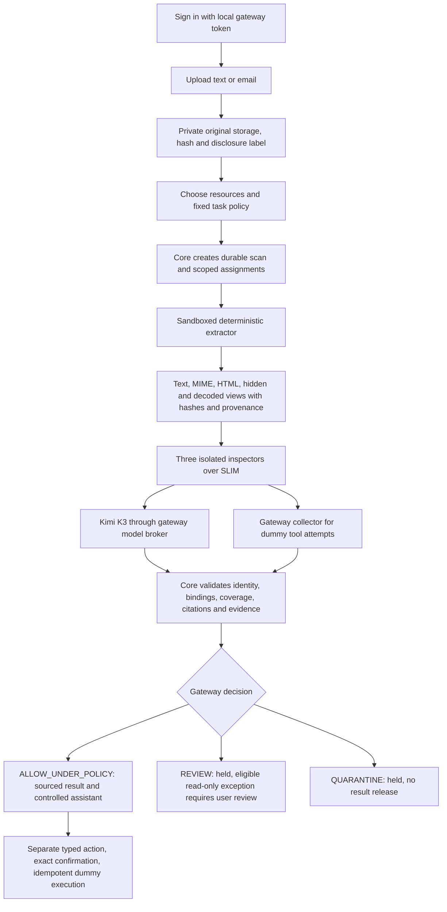

# Pipeline and repeatable testing

The local application now works end to end with **Kimi K3**. Tested October
10, 2026 on this Mac using Python 3.12.13, pytest 8.4.2, SLIM bindings 2.2.0
and uvicorn 0.53.0. Dependencies were installed with hashes from
`requirements.lock`; the repository now has its own `.venv`.

## What happens when you add a file

Uploading stores the original privately; it does not start inspection. Select
uploaded resources and a task policy, then press **Start inspection**.



The extractor has no model access. Instruction, data/tool, and behavior
inspectors receive only their assigned views. Kimi credentials remain in the
gateway; workers use a broker with a fixed endpoint/model, budgets and leases.
Model citations may use an exact unique quote; the worker resolves it into
Unicode character offsets and checks the view hash. Missing, repeated or
fabricated quotes do not become accepted evidence. Invoice values must match
their cited source exactly. Summary citation checks establish provenance, but
do not prove the meaning of every generated statement.

Only the core grants a decision or release. Missing coverage, malformed
results, errors, unsupported relevant attachments or deadlines keep content
held. Signed gateway collector evidence of a forbidden dummy action causes
quarantine even when a worker's final answer looks harmless. Raw evidence is
available separately to the owner and is not passed to controlled chat.

An eligible review exception is read-only, bound to the user, result digest,
context and expiry; the decision remains REVIEW. The UI clears released text
at the exception expiry even when the scan decision expires later. Sending requires a separate
proposal and exact user confirmation. The executor records a **simulation**;
it sends no real email.

## What was repaired

| Previous behavior | Current behavior |
| --- | --- |
| Bootstrap could not attach the existing core; real routes returned 503 | Explicit `--dev` composition attaches core, storage, runtime, workers and adapters |
| Worker/core assignment and result shapes disagreed | Gateway bridge translates contracts and rechecks persisted identity and scope |
| Derived source maps referred to parent views | Bridge composes them back to original byte ranges |
| No configured live provider path for the supplied key | `.env` loads as data and Kimi K3 uses the pinned chat endpoint |
| Inspector prompts suggested task output to every role; model offsets were unreliable | Role-specific response contracts and verified literal-quote citations |
| UI expected different status, review, evidence and action fields | UI uses the actual core API; local sign-in establishes cookie and CSRF |
| Simulate-send behavior had no supported task context | Documents are inspected and summarized; user-proposed dummy actions use the separate action gate |
| End-to-end proof depended on absent external factories | `make test-e2e` runs the actual local stack with deterministic inference; `make smoke` uses live Kimi |

## Results and evidence

- Regression suite: **304 passed, 3 skipped**. The eight new HTTP end-to-end
  cases run the actual local stack, including the MCP and decoded-view checks.
- Live Kimi K3 smoke: all five journeys passed. A clean invoice was allowed;
  injected instructions produced REVIEW and required a recorded exception;
  a PDF attachment stayed held without an eligible exception; confirmed dummy
  sending was idempotent; cancellation revoked result access.
- Real browser: signed in, selected a file through the upload control, started
  all Kimi inspections, displayed the four expected invoice values and their
  source references, then opened the controlled assistant result. No fetch
  mocking was used for this journey. Browser storage remained empty.
- UI regression harness: **18 passed at desktop and 18 at mobile width**.
  These checks use API doubles and are separate from the real browser proof.
  They cover stale responses, inactive malicious markup, evidence separation,
  review, quarantine, editing during confirmation, expiry, cancellation,
  selected-resource limits and outages.
- Startup capability checks pass for core, sandbox isolation, SLIM, collector,
  model broker, extraction, inspection and adapters. A successful capability
  check verifies wiring, not whether the provider accepts your credential;
  the live smoke test verifies provider calls.

Local evidence, ignored by Git: `.gstack/final-tests.log`,
`.gstack/final-tests.xml`, `.gstack/e2e-tests.log`, `.gstack/live-smoke.json`,
`.gstack/browser-real.json`, `.gstack/browser-real-desktop.png`, and
`.gstack/browser-regressions-{desktop,mobile}.json`.

The three skipped cases are the old externally configured reviewed-scenario
release driver, a real native Claude/ChatGPT account connector smoke, and one
SHADI-specific case on macOS. They are not claimed as passes. This local
browser/API/MCP verification does not establish production deployment,
SHADI-on-Linux behavior or a native account connection. The proposed 22-case
release manifest still requires its separate reviewed driver and native account.

## Start it later

Run from the repository in a normal terminal with local socket access:

```sh
cd /Users/advaithnair/Documents/GitHub/hackdevcomp
make setup
```

Python 3.11 or later is required. The default setup command uses `python3.12`;
on another host use `make setup PYTHON=python3.11` or another supported Python.
Your existing `.env` with `KIMI_API_KEY` is loaded automatically. Do not paste
the key into the browser; it stays on the gateway. Optional settings are in
`deploy/local.env.example`. The configured model is `kimi-k3`, reasoning
`low`, with a 120-second model timeout and 4096 output-token limit. Model and
reasoning configuration are bound into scans.

```sh
make check                 # exits nonzero if any required capability is missing
make run                   # actual gateway at http://127.0.0.1:8766/ui
```

Sign in with the contents of `var/runtime/login-token`. This is a separate,
private local authentication token generated on first development startup.
`--dev` explicitly permits private, unencrypted local evidence storage and
requires loopback. It is not a production deployment configuration. Stop with
Ctrl-C. To use a different port, pass `PORT=8877` to both `make run` and
`make smoke`. Do not run two gateways against the same state directory.

## Automated tests you can repeat

```sh
make test                  # unit/contract suite, no live model calls
make test-e2e              # eight real-stack HTTP/MCP cases, deterministic inference
make test-isolation        # host sandbox and real SLIM checks
PG_REQUIRE_ISOLATION=1 .venv/bin/python -m pytest -ra  # all tests
.venv/bin/python -m pip check
```

`make test-e2e` launches its own temporary local server and the actual extractor
and inspectors in the verified sandbox. Only provider inference is replaced;
there are no fake workers, core, database, collector, HTTP routes or SLIM
transport. It tests normal and injected inputs, malformed source spans,
missing coverage, a forbidden collector action surviving final-output loss,
origin/CSRF rejection, decoded-view provenance, unknown dummy tool rejection,
the three scoped MCP tools, review and dummy action
confirmation/replay. A missing host sandbox fails this target.

With `make run` still running in another terminal:

```sh
make smoke
# Or save a machine-readable report:
.venv/bin/python scripts/smoke_test.py \
  --url http://127.0.0.1:8766 \
  --token-file var/runtime/login-token \
  --output /tmp/gateway-smoke.json
```

This uses live Kimi calls and API credits. It sends only the included synthetic
invoice, injected instruction and meeting text. It does not send emails or
inspect your private documents. The script exits nonzero on an unexpected
outcome; a live model's decision can vary, and provider errors keep content
held rather than pretending that inspection passed.

## Browser test you can repeat

1. Open `http://127.0.0.1:8766/ui` and sign in with the local gateway token.
2. Upload `tests/fixtures/e2e/invoice.txt`. It should appear as a checked
   resource; upload alone should not release a result.
3. Choose **Extract invoice fields** and press **Start inspection**. During
   processing, the result button must stay disabled. Expect four completed
   checks and ALLOW_UNDER_POLICY.
4. Press **View permitted result**. Expect invoice ID `INV-100`, amount
   `25.00`, currency `USD` and due date `2026-12-01`, with source references
   and labels. **Open in controlled assistant** should show that result.
5. Upload `injected-invoice.txt`, select only that resource and inspect it.
   Expect REVIEW or QUARANTINE and no automatic result release. If REVIEW is
   eligible, inspect the separate evidence and request a read-only exception;
   the decision must remain REVIEW.
6. Upload `unsupported-attachment.eml`, select only it and inspect. Expect
   REVIEW, unsupported-content coverage and no eligible read-only exception.
7. For **Simulate a confirmed email action**, inspect a benign text source,
   enter a recipient, subject and exact body, and create a proposal. No effect
   should occur until the preview checkbox is checked and you confirm.
   Changing the draft must discard the old proposal. The final state should
   be EXECUTED, simulation only.
8. Cancel a completed scan: previously released content should clear and
   a later result read should be denied. Change selected resources or policy:
   the previous task and action should clear from the page.

The optional gstack UI harness is `tests/adapters/ui-browser.js`. On a fresh,
authenticated page use `/browse` to evaluate a copy of that file from the
browser's permitted directory. It reports 18 checks using API doubles; reload
afterward. For ordinary manual testing, the steps above use the real backend.

## Troubleshooting

- A restricted executor may deny loopback socket creation; run tests in your
  normal local terminal. There is no unsandboxed worker fallback.
- Failed capability checks identify the missing runtime component. A live
  provider authentication, balance, rate-limit or response-format failure
  withholds content; inspect the gateway's bounded reason-code logs.
- If a page's session expires, refresh and sign in again. Review and action
  approvals are user/session operations, not bearer-token MCP capabilities.
- A source-supported summary may still be factually wrong. The gateway is an
  authorization and evidence boundary, not proof of perfect model judgment.
